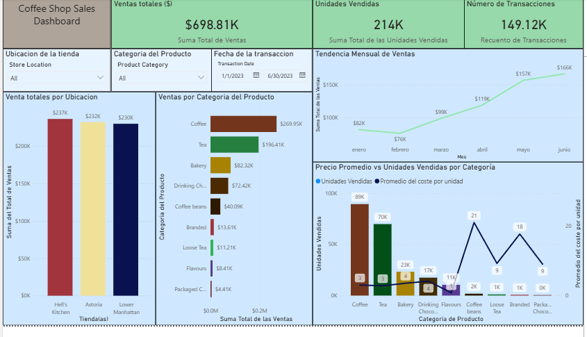
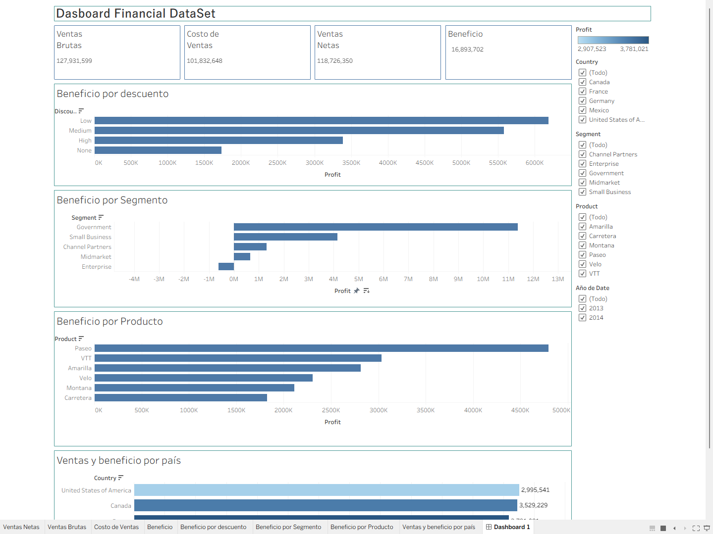
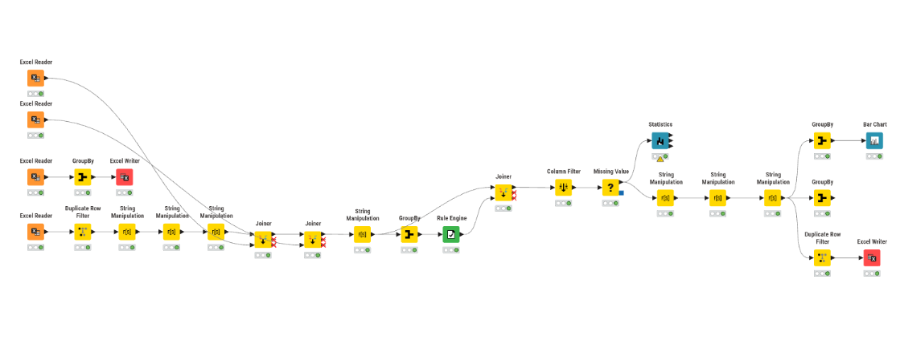

# Business Analytics Portfolio | Fabian Garita

Operations Support professional with experience in performance monitoring, root cause analysis, and process improvement. Currently pursuing a Technical Diploma in Business Analytics at Universidad CENFOTEC.

## Featured Project: Operational Defect & Root Cause Analysis

**Tools:** Power BI | Power Query | DAX | Data Visualization

An interactive dashboard developed using synthetic operational data to demonstrate KPI monitoring, defect analysis, and data-driven decision-making.

### Dashboard Preview

### Key Results

- **Total Jobs:** 3,813
- **Total Defects:** 497
- **Overall Defect Rate:** 13.03%
- **Leading Root Cause:** Routing — 148 defects (29.8% of total)
- **Lowest Weekly Defect Rate:** 6.92% in Week 5
- **Highest Weekly Defect Rate:** 18.97% in Week 8

### Analytical Insights

Routing represents the largest share of recorded defects. The defect rate also increased between Weeks 5 and 8, highlighting an opportunity for further investigation.

### Technical Implementation

- Data preparation and transformation with Power Query
- KPI calculations using DAX measures
- Interactive filtering by week and root cause
- Trend analysis and executive-level data storytelling

### Project Files

- [Power BI Dashboard](Operational_Root_Cause_Analysis.pbix)
- [Synthetic Dataset](synthetic_defects.csv)

**Data Disclaimer:** This is a fictional demonstration using synthetic data. It does not contain ORG operational records or confidential business information.

---

Additional projects in R, KNIME, and Tableau will be added as the portfolio develops.

---

## Project 02: Coffee Shop Sales Analysis

**Tools:** Power BI | Power Query | Data Visualization

### Project Overview

An interactive sales dashboard developed in Power BI to analyze coffee shop performance across multiple store locations, product categories, and time periods.

The dashboard provides insights into revenue distribution, sales trends, transaction volume, and product performance.

### Dashboard Preview

### Key Performance Indicators

- **Total Sales:** $698.81K
- **Units Sold:** 214K
- **Transactions:** 149.12K
- **Top Product Category:** Coffee
- **Top Performing Location:** Hell's Kitchen

### Key Insights

- Coffee generated approximately $269.95K in sales, making it the leading product category.
- Hell's Kitchen recorded the highest sales among the three locations.
- Monthly revenue increased from approximately $82K in January to $166K in June.

### Technical Skills Demonstrated

- Interactive dashboard development in Power BI
- Sales performance and KPI analysis
- Data visualization and trend identification
- Filtering by location, product category, and date
- Comparative analysis of store performance

### Project File

[Download Power BI Dashboard](Coffee_Shop_Sales_Analysis.pbix)

---

## Project 03: Financial Performance Analysis — Tableau

**Tools:** Tableau | Financial Analytics | Data Visualization

### Project Overview

Interactive financial dashboard analyzing sales, costs, profits, and business performance across products, segments, countries, and discount categories.

### Dashboard Preview

### Key Results

- Gross Sales: 127,931,599
- Net Sales: 118,726,350
- Cost of Sales: 101,832,648
- Total Profit: 16,893,702

### Analysis Features

- Profit analysis by product and business segment
- Financial performance by discount category
- Sales and profit comparisons across countries
- Interactive filtering by country, segment, product, and year

### Project File

[Download Tableau Workbook](Financial_Performance_Tableau.twbx)

---

---

## Project 04: University Data Integration & Cleaning — KNIME

**Tools:** KNIME | ETL | Data Cleaning | Data Integration

### Project Overview

Academic data analytics project developed in KNIME to integrate, clean, transform, and analyze university enrollment data.

The workflow demonstrates practical data preparation techniques and structured data processing to support academic reporting.

### Technical Skills Demonstrated

- Excel data import and integration
- Duplicate detection and removal
- Missing value handling
- Data transformation using String Manipulation
- Data integration using Joiner nodes
- Aggregation and analysis using GroupBy
- Business rules using Rule Engine
- Statistical analysis and data visualization
- Exporting processed results to Excel

### Workflow Preview

### Project File

[Download KNIME Workflow](Universidad_Futuro_BAII.knwf)

**Note:** The original academic workflow is provided for demonstration purposes. Source datasets are not included, and local file connections may require reconfiguration.

---

