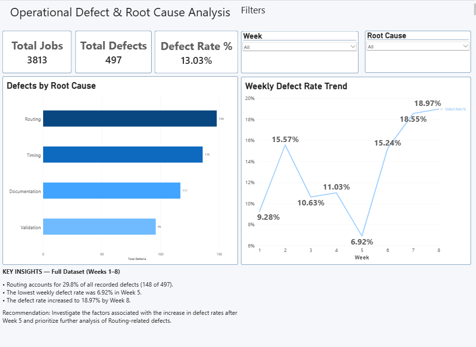

# Business Analytics Portfolio | Fabian Garita

Operations Support professional with experience in performance monitoring, root cause analysis, and process improvement. Currently pursuing a Technical Diploma in Business Analytics at Universidad CENFOTEC.

## Featured Project: Operational Defect & Root Cause Analysis

**Tools:** Power BI | Power Query | DAX | Data Visualization

An interactive dashboard developed using synthetic operational data to demonstrate KPI monitoring, defect analysis, and data-driven decision-making.

### Dashboard Preview

### Key Results

- **Total Jobs:** 3,813
- **Total Defects:** 497
- **Overall Defect Rate:** 13.03%
- **Leading Root Cause:** Routing — 148 defects (29.8% of total)
- **Lowest Weekly Defect Rate:** 6.92% in Week 5
- **Highest Weekly Defect Rate:** 18.97% in Week 8

### Analytical Insights

Routing represents the largest share of recorded defects. The defect rate also increased between Weeks 5 and 8, highlighting an opportunity for further investigation.

### Technical Implementation

- Data preparation and transformation with Power Query
- KPI calculations using DAX measures
- Interactive filtering by week and root cause
- Trend analysis and executive-level data storytelling

### Project Files

- [Power BI Dashboard](Operational_Root_Cause_Analysis.pbix)
- [Synthetic Dataset](synthetic_defects.csv)

**Data Disclaimer:** This is a fictional demonstration using synthetic data. It does not contain ORG operational records or confidential business information.

---

Additional projects in R, KNIME, and Tableau will be added as the portfolio develops.
